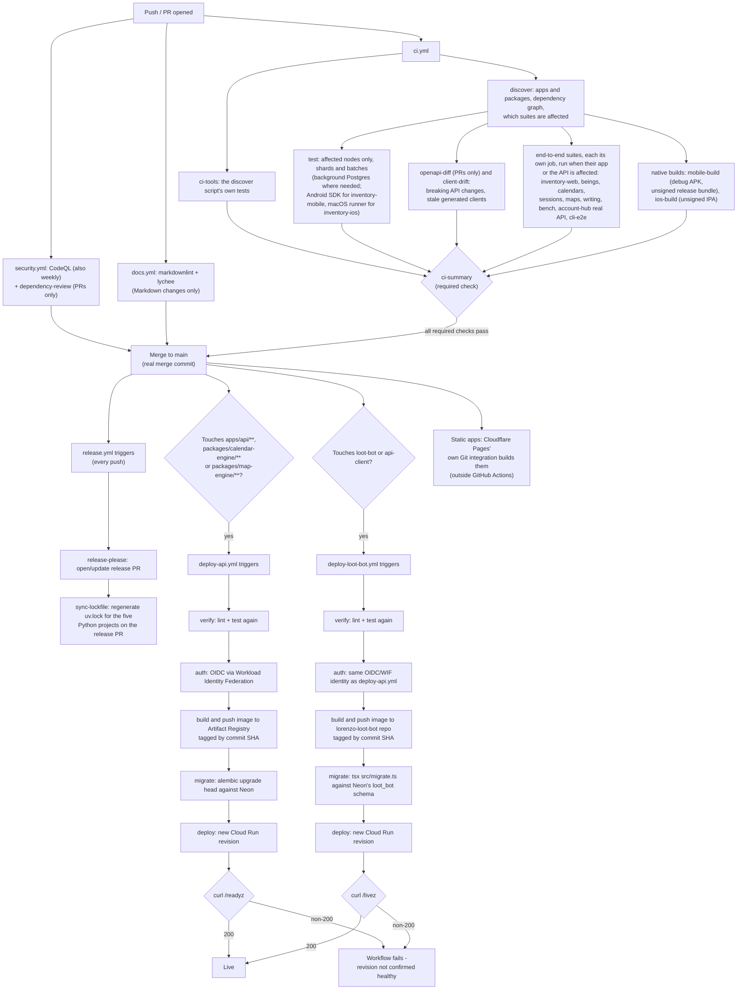

# CI/CD pipeline flowchart

`ci-summary` aggregates the CI jobs; the separate security and documentation workflows run alongside it. Which nodes and suites a change reaches is decided by `discover` from the dependency graph, derived from `package.json` and `pyproject.toml` plus the hand-written [`.github/ci-graph.toml`](../../../.github/ci-graph.toml) ([ADR 0148](../../adr/0148-dependency-aware-pr-ci.md)); a push to `main` runs everything. A node CI cannot read (Kotlin, Swift, plain CSS) is declared there, which is why `apps/inventory-mobile`, `apps/inventory-ios` and `apps/brand` have entries of their own. The suites in the graph are `inventory-web-e2e`, `beings-e2e`, `bench-e2e`, `calendars-e2e`, `sessions-e2e`, `maps-e2e`, `writing-e2e`, `account-hub-real-api` and `cli-e2e` (Playwright, or the CLI, against the real API and a fake Authgear), plus `mobile-build` and `ios-build`; `apps/calendars`, `apps/sessions`, `apps/maps` and `apps/writing` are ordinary nodes beside the other web apps, with their shared packages (`packages/map-engine`, `packages/map-renderer`, `packages/entry-preview` and others) declared the same way.

Three independent triggers can fire off the same push to `main`: `release.yml` (always, proposing/updating a version bump and keeping the release PR's lockfiles in step), `deploy-api.yml` (only if the push touches `apps/api/**`, `packages/calendar-engine/**` or `packages/map-engine/**`, which the API image bundles), and `deploy-loot-bot.yml` (only if it touches `apps/loot-bot/**` or `packages/api-client/**`, [ADR 0053](../../adr/0053-loot-bot-http-interactions-and-cloud-run-deploy.md)). None depend on each other — a release PR being merged doesn't itself deploy anything, and a deploy doesn't wait for a release to be tagged. The static web apps have no equivalent job in this repo at all — Cloudflare Pages' own Git integration deploys them independently on the same push, outside GitHub Actions entirely (see [deployment.md](../deployment.md#static-apps-on-cloudflare-pages)), and the Android and iOS apps are built by CI but installed locally, not deployed (see [deployment.md](../deployment.md#native-apps)). See [docs/operations/releasing.md](../../operations/releasing.md) and [docs/architecture/deployment.md](../deployment.md).
