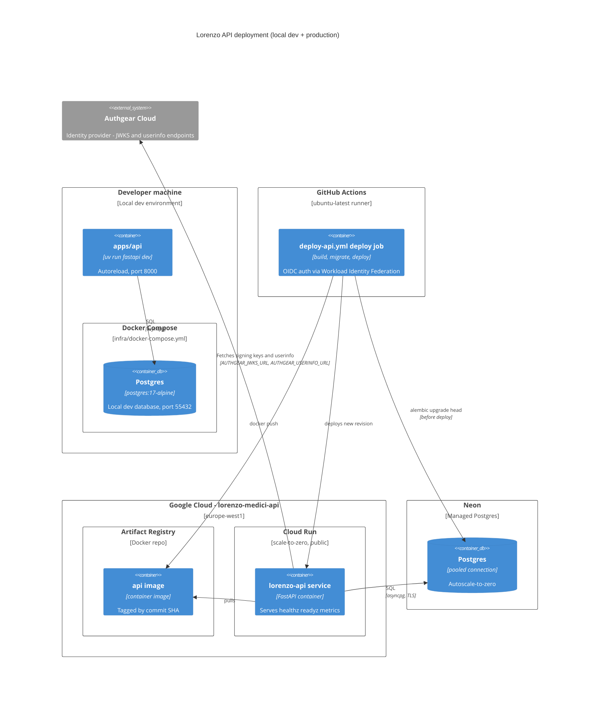
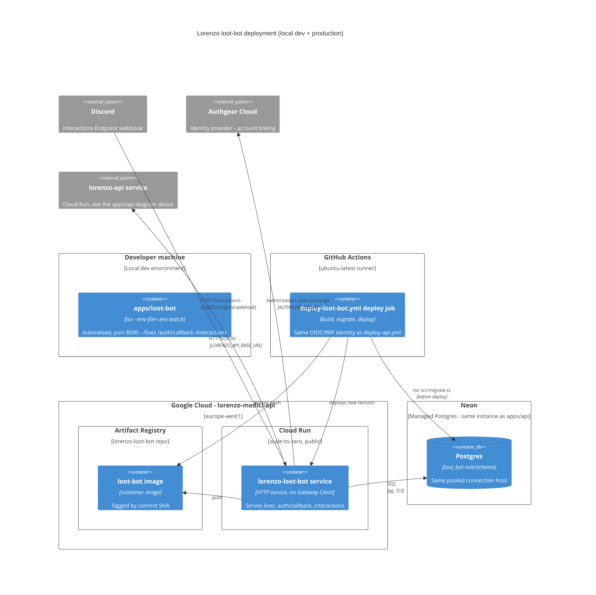
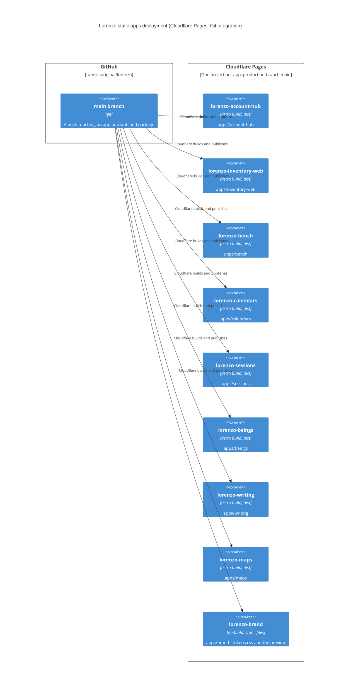

# Deployment diagrams

## apps/api

## apps/loot-bot

Same GCP project/region and the same Neon instance as `apps/api` above (a separate `loot_bot` role/schema, not a separate database) - a second Artifact Registry repo and Cloud Run service, reusing the same Workload Identity Federation pool/provider/service account rather than a parallel one ([ADR 0053](../../adr/0053-loot-bot-http-interactions-and-cloud-run-deploy.md)).

## Static apps on Cloudflare Pages

`apps/account-hub`, `apps/inventory-web`, `apps/beings`, `apps/bench`, `apps/calendars`, `apps/sessions`, `apps/writing`, `apps/maps` and `apps/brand` deploy the same way: a static build served by Cloudflare Pages, wired to Cloudflare's own Git integration (no GitHub Actions job, no container, no database), rebuilt on a push to `main` that touches the app or a watched package. They call the API on Cloud Run from the browser (the API's `CORS_ALLOWED_ORIGINS` has to list each origin) and sign in through Authgear with a public client of their own.

The apps' addresses, and the links between them, are served by the API's registry, `GET /app-links` ([ADR 0273](../../adr/0273-app-links-registry.md)); an address the registry does not set (one variable per app, eight in all, see [deployment.md](../deployment.md#static-apps-on-cloudflare-pages)) falls back to the official `https://lorenzo-<app>.pages.dev`. Setup, one app each: [deployment-setup.md](../../operations/deployment-setup.md) (account-hub, inventory-web, bench, brand), [beings-setup.md](../../operations/beings-setup.md), [calendars-setup.md](../../operations/calendars-setup.md), [sessions-setup.md](../../operations/sessions-setup.md), [writing-setup.md](../../operations/writing-setup.md) and [maps-setup.md](../../operations/maps-setup.md). See [docs/architecture/deployment.md](../deployment.md#static-apps-on-cloudflare-pages) for the prose version.

## Native apps

`apps/inventory-mobile` (Android) and `apps/inventory-ios` are not deployed anywhere: both are installed locally. Android installs a locally built debug APK; iOS builds an unsigned IPA in CI that is signed locally with AltStore Classic ([ADR 0291](../../adr/0291-inventory-mobile-native-android-app.md), [ADR 0307](../../adr/0307-inventory-ios-and-altstore-testing.md)). See [docs/architecture/deployment.md](../deployment.md#native-apps) for the prose version; the same file has a local-vs-deployed comparison table for `apps/api`.
