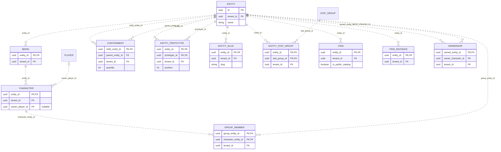
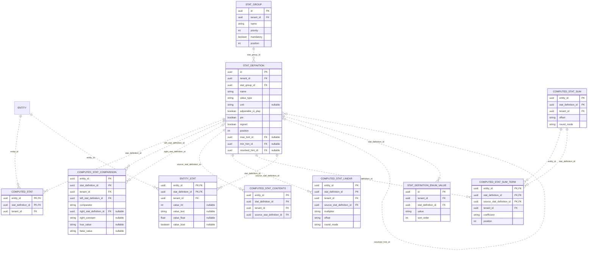
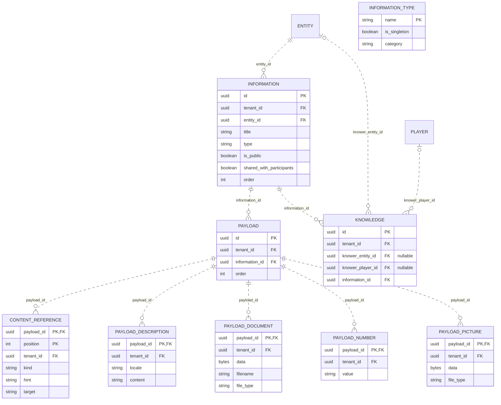
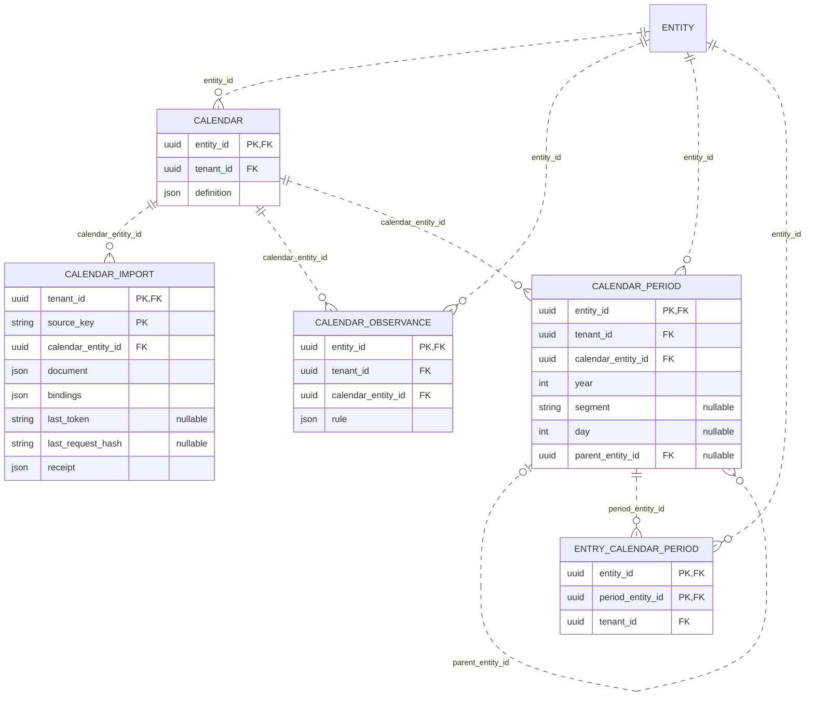
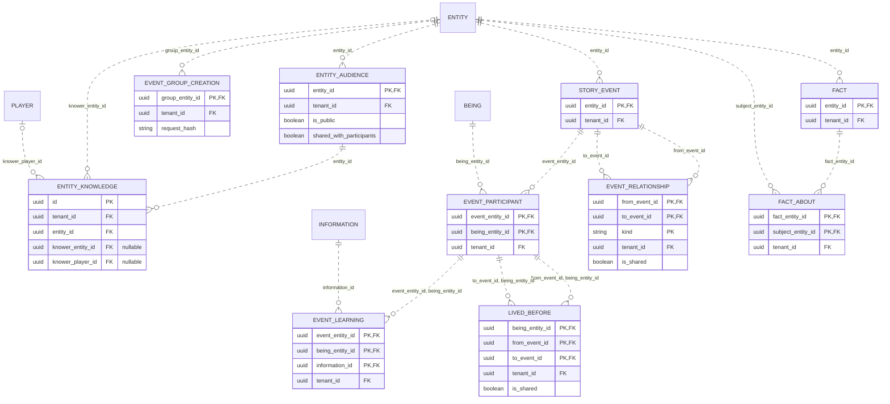

# ER diagram: domain model

A snapshot of the 89 stored API tables, checked against [`models/`](../../../apps/api/src/lorenzo_api/models) on 2026-10-22. The diagrams are grouped to keep the entry/component core, stat vocabulary, information, calendars, Events and Facts, Sessions and Scenes, accounts and repository machinery readable. A table referenced from another group appears there by name only; its columns are defined in its own group.

Columns show primary and foreign keys and nullable values. Routine `created_at`/`updated_at` and `created_by`/`updated_by` columns and their attribution edges are omitted; timestamps and attribution differ by table, so consult the model and [ADR 0029](../../adr/0029-attribution-created-by-updated-by.md) for their exact shape. Views (`v_item`, `v_item_instance`, `v_character`, `v_effective_stat`) are reads over these tables, not stored tables.

Relationship lines are foreign-key references: dotted lines do not claim a cascade or ownership rule. A same-tenant composite foreign key is drawn once by its non-tenant column; every tenant table still carries `tenant_id` and enforced RLS. Unique constraints, checks, trigger rules and delete actions are defined in the migrations and the [ADR index](../../adr/README.md), not reproduced here.

## Entries, inheritance, containment and ownership

## Stat vocabulary and formulas

## Information and payloads

## People, campaigns, credentials and activity

```mermaid
erDiagram
    APP_USER |o..o{ APP_USER : "suspended_by"
    APP_USER |o..o{ AUDIT_LOG : "actor_id"
    ENTITY ||..o{ CAMPAIGN : "entity_id"
    CAMPAIGN ||..o{ CAMPAIGN_GM : "campaign_id"
    APP_USER ||..o{ CAMPAIGN_GM : "user_id"
    CAMPAIGN ||..o{ CAMPAIGN_PROFILE_PICTURE : "campaign_id"
    PROFILE_PICTURE ||..o{ CAMPAIGN_PROFILE_PICTURE : "profile_picture_id"
    CHARACTER ||..o{ CHARACTER_PLAYER : "character_entity_id"
    PLAYER ||..o{ CHARACTER_PLAYER : "player_id"
    APP_USER |o..o{ DEVICE_AUTHORIZATION : "user_id"
    APP_USER |o..o{ ENTITY_CHANGE : "actor_user_id"
    APP_USER ||..o{ ENTITY_CHANGE : "user_id"
    CAMPAIGN |o..o{ INVITE : "campaign_id"
    APP_USER ||..o{ MEMBERSHIP : "user_id"
    APP_USER ||..o{ NOTIFICATION : "user_id"
    APP_USER ||..o{ PERSONAL_ACCESS_TOKEN : "user_id"
    CAMPAIGN ||..o{ PLAYER : "campaign_id"
    APP_USER ||..o{ PLAYER : "user_id"
    REPOSITORY_RELEASE |o..o{ TENANT : "current_release_id"
    REPOSITORY_RELEASE ||..o{ TENANT : "id"
    STAT_GROUP ||..o{ TENANT : "id"
    STAT_GROUP |o..o{ TENANT : "being_stat_group_id"
    STAT_GROUP |o..o{ TENANT : "weapon_stat_group_id"
    APP_USER |o..o{ TENANT : "delisted_by"
    CAMPAIGN ||..o{ TENANT_ADMIN_CAMPAIGN_OPT_OUT : "campaign_id"
    APP_USER ||..o{ TENANT_ADMIN_CAMPAIGN_OPT_OUT : "user_id"
    PROFILE_PICTURE ||..o{ TENANT_PROFILE_PICTURE : "profile_picture_id"
    PROFILE_PICTURE ||..o{ USER_PROFILE_PICTURE : "profile_picture_id"
    APP_USER ||..o{ USER_PROFILE_PICTURE : "user_id"
    APP_USER {
        uuid id PK
        string authgear_subject_id
        string email "nullable"
        string nickname "nullable"
        datetime suspended_at "nullable"
        uuid suspended_by FK "nullable"
        string suspension_reason "nullable"
        string display_name "nullable"
        string pronouns "nullable"
        string bio "nullable"
        array locales
        string user_color "nullable"
        array last_seen_roles
    }
    AUDIT_LOG {
        uuid id PK
        uuid tenant_id FK
        uuid actor_id FK "nullable"
        string action
        string target_type
        uuid target_id "nullable"
        string detail "nullable"
    }
    CAMPAIGN {
        uuid id PK
        uuid tenant_id FK
        string name
        string game_system
        string slug
        string description
        boolean secret
        boolean player_self_service
        string gm_title "nullable"
        string gm_title_plural "nullable"
        uuid entity_id FK
    }
    CAMPAIGN_GM {
        uuid tenant_id PK,FK
        uuid user_id PK,FK
        uuid campaign_id PK,FK
    }
    CAMPAIGN_PROFILE_PICTURE {
        uuid campaign_id PK,FK
        uuid tenant_id FK
        uuid profile_picture_id FK
    }
    CHARACTER_PLAYER {
        uuid character_entity_id PK,FK
        uuid player_id PK,FK
        uuid tenant_id FK
    }
    DEVICE_AUTHORIZATION {
        uuid id PK
        string device_code_hash
        string user_code
        string client_name "nullable"
        string status
        uuid user_id FK "nullable"
        string token_name "nullable"
        datetime token_expires_at "nullable"
        datetime expires_at
        datetime last_polled_at "nullable"
    }
    ENTITY_CHANGE {
        uuid id PK
        uuid tenant_id FK
        uuid user_id FK
        uuid character_entity_id
        uuid entity_id
        string kind
        string entity_name
        string detail "nullable"
        uuid actor_user_id FK "nullable"
        boolean actor_visible
        datetime occurred_at
    }
    INVITE {
        uuid id PK
        uuid tenant_id FK
        string kind
        uuid campaign_id FK "nullable"
        string token_hash
        string role "nullable"
        datetime expires_at
        int max_uses "nullable"
        int use_count
        datetime revoked_at "nullable"
    }
    MEMBERSHIP {
        uuid tenant_id PK,FK
        uuid user_id PK,FK
        string role
    }
    NOTIFICATION {
        uuid id PK
        uuid batch_id
        uuid user_id FK
        uuid tenant_id FK "nullable"
        string scope
        uuid source_id "nullable"
        string type
        string title
        string body
        datetime read_at "nullable"
    }
    PERSONAL_ACCESS_TOKEN {
        uuid id PK
        uuid user_id FK
        string name
        string token_hash
        string token_hint
        datetime last_used_at "nullable"
        datetime expires_at "nullable"
        datetime revoked_at "nullable"
    }
    PLAYER {
        uuid id PK
        uuid user_id FK
        uuid campaign_id FK
        uuid tenant_id FK
        boolean self_service "nullable"
    }
    PROFILE_PICTURE {
        uuid id PK
        bytes data
        string file_type
    }
    TENANT {
        uuid id PK,FK
        string name
        string slug
        string description
        string kind
        datetime published_at "nullable"
        datetime delisted_at "nullable"
        uuid delisted_by FK "nullable"
        string delist_reason "nullable"
        uuid current_release_id FK "nullable"
        boolean npcs_shared_with_gms
        int export_revision
        uuid being_stat_group_id FK "nullable"
        uuid weapon_stat_group_id FK "nullable"
        string ability_information_type "nullable"
    }
    TENANT_ADMIN_CAMPAIGN_OPT_OUT {
        uuid tenant_id PK,FK
        uuid user_id PK,FK
        uuid campaign_id PK,FK
    }
    TENANT_PROFILE_PICTURE {
        uuid tenant_id PK,FK
        uuid profile_picture_id FK
    }
    USER_PROFILE_PICTURE {
        uuid user_id PK,FK
        uuid profile_picture_id FK
    }
```

## Repositories, copies, profiles and releases

```mermaid
erDiagram
    APP_USER |o..o{ REPOSITORY_COPY : "copied_by"
    ENTITY |o..o{ REPOSITORY_COPY_LINK_ENTITY : "entity_id"
    STAT_DEFINITION |o..o{ REPOSITORY_COPY_LINK_STAT_DEFINITION : "stat_definition_id"
    STAT_GROUP |o..o{ REPOSITORY_COPY_LINK_STAT_GROUP : "stat_group_id"
    PROFILE_PICTURE |o..o{ REPOSITORY_PROFILE : "cover_picture_id"
    REPOSITORY_RELEASE |o..o{ RELEASE_FANOUT : "release_id"
    REPOSITORY_RELEASE ||..o{ REPOSITORY_RELEASE_DOCUMENT : "release_id"
    ENTITY ||..o{ REPOSITORY_SHOWCASE : "entity_id"
    TENANT ||..o{ REPOSITORY_SUBSCRIPTION : "repository_tenant_id"
    TENANT ||..o{ REPOSITORY_SUBSCRIPTION : "subscriber_tenant_id"
    REPOSITORY_COPY {
        uuid tenant_id
        uuid repository_tenant_id PK
        string repository_name
        datetime copied_at
        uuid copied_by FK "nullable"
        datetime synced_at
        uuid synced_release_id "nullable"
    }
    REPOSITORY_COPY_LINK_ATTACHMENT {
        uuid tenant_id
        uuid source_tenant_id PK
        uuid child_source_id PK
        uuid parent_source_id PK
        datetime copied_at
    }
    REPOSITORY_COPY_LINK_ENTITY {
        uuid tenant_id PK,FK
        uuid source_id PK
        uuid source_tenant_id
        uuid entity_id FK "nullable"
        json snapshot
        datetime copied_at
    }
    REPOSITORY_COPY_LINK_STAT_DEFINITION {
        uuid tenant_id PK,FK
        uuid source_id PK
        uuid source_tenant_id
        uuid stat_definition_id FK "nullable"
        string mode
        json snapshot
        datetime copied_at
    }
    REPOSITORY_COPY_LINK_STAT_GROUP {
        uuid tenant_id PK,FK
        uuid source_id PK
        uuid source_tenant_id
        uuid stat_group_id FK "nullable"
        string mode
        json snapshot
        datetime copied_at
    }
    REPOSITORY_PROFILE {
        uuid tenant_id PK,FK
        string visibility
        string preview
        string summary
        string licence_label "nullable"
        string licence_url "nullable"
        json credits
        array tags
        string system "nullable"
        array languages
        uuid cover_picture_id FK "nullable"
        string release_label "nullable"
        datetime released_at "nullable"
        int entry_count "nullable"
        int stat_definition_count "nullable"
    }
    REPOSITORY_RELEASE {
        uuid id PK
        uuid tenant_id FK
        int number
        string label
        string notes "nullable"
        boolean breaking
        string digest "nullable"
        json counts "nullable"
        json breaking_rows
        json warning_rows
    }
    RELEASE_FANOUT {
        uuid id PK
        uuid tenant_id FK
        uuid release_id FK "nullable"
        string type
        string title
        string body
        array recipients
        int cursor
        datetime done_at "nullable"
    }
    REPOSITORY_RELEASE_BLOB {
        uuid tenant_id PK,FK
        string sha256 PK
        bytes data
    }
    REPOSITORY_RELEASE_DOCUMENT {
        uuid release_id PK,FK
        uuid tenant_id FK
        int format
        bytes content
        array blobs
    }
    REPOSITORY_RELEASED_ROW {
        uuid id PK
        uuid tenant_id FK
        string kind
        uuid row_id
        uuid parent_id "nullable"
        string hash
        string name
        json facts
    }
    REPOSITORY_SHOWCASE {
        uuid entity_id PK,FK
        uuid tenant_id FK
        int position
    }
    REPOSITORY_SUBSCRIPTION {
        uuid repository_tenant_id PK,FK
        uuid subscriber_tenant_id PK,FK
        string source
    }
```

## Calendars and dates

## Events, Facts and audiences

## Sessions and Scenes

```mermaid
erDiagram
    CALENDAR_PERIOD |o..o{ SCENE : "period_entity_id"
    ENTITY ||..o{ SCENE : "entity_id"
    ENTITY ||..o{ SCENE_APPEARANCE : "entity_id"
    SCENE ||..o{ SCENE_APPEARANCE : "scene_entity_id"
    STORY_SESSION ||..o{ SCENE_APPEARANCE : "session_entity_id"
    SCENE ||..o{ SCENE_BEING : "scene_entity_id"
    BEING ||..o{ SCENE_BEING : "being_entity_id"
    SCENE ||..o{ SCENE_EVENT : "scene_entity_id"
    STORY_EVENT ||..o{ SCENE_EVENT : "event_entity_id"
    SCENE ||..o{ SCENE_FACT : "scene_entity_id"
    FACT ||..o{ SCENE_FACT : "fact_entity_id"
    SCENE_APPEARANCE ||..o{ EVENT_PRESENTATION : "appearance_entity_id"
    STORY_EVENT ||..o{ EVENT_PRESENTATION : "event_entity_id"
    SESSION_PLAYER ||..o{ SESSION_CHARACTER : "session_entity_id, player_id"
    CHARACTER_PLAYER ||..o{ SESSION_CHARACTER : "character_entity_id, player_id"
    STORY_SESSION ||..o{ SESSION_EVENT : "session_entity_id"
    STORY_EVENT ||..o{ SESSION_EVENT : "event_entity_id"
    STORY_SESSION ||..o{ SESSION_FACT : "session_entity_id"
    FACT ||..o{ SESSION_FACT : "fact_entity_id"
    STORY_SESSION ||..o{ SESSION_GM : "session_entity_id"
    APP_USER ||..o{ SESSION_GM : "user_id"
    STORY_SESSION ||..o{ SESSION_PLAYER : "session_entity_id, campaign_id"
    PLAYER ||..o{ SESSION_PLAYER : "player_id, campaign_id"
    STORY_SESSION ||..o{ SESSION_SEQUENCE : "session_entity_id, campaign_id"
    ENTITY ||..o{ STORY_SESSION : "entity_id"
    CAMPAIGN ||..o{ STORY_SESSION : "campaign_id"
    CALENDAR_PERIOD |o..o{ STORY_SESSION : "start_period_id"
    EVENT_PRESENTATION {
        uuid id PK
        uuid tenant_id FK
        uuid appearance_entity_id FK
        uuid event_entity_id FK
        int position
        boolean is_shared
    }
    SCENE {
        uuid entity_id PK,FK
        uuid tenant_id FK
        uuid period_entity_id FK "nullable"
    }
    SCENE_APPEARANCE {
        uuid entity_id PK,FK
        uuid tenant_id FK
        uuid session_entity_id FK
        uuid scene_entity_id FK
        int position
        boolean is_shared
        string play_status
        int played_position "nullable"
    }
    SCENE_BEING {
        uuid scene_entity_id PK,FK
        uuid being_entity_id PK,FK
        uuid tenant_id FK
        boolean is_shared
    }
    SCENE_EVENT {
        uuid scene_entity_id PK,FK
        uuid event_entity_id PK,FK
        uuid tenant_id FK
        boolean is_shared
    }
    SCENE_FACT {
        uuid scene_entity_id PK,FK
        uuid fact_entity_id PK,FK
        uuid tenant_id FK
        boolean is_shared
    }
    SESSION_CHARACTER {
        uuid session_entity_id PK,FK
        uuid player_id PK,FK
        uuid character_entity_id PK,FK
        uuid tenant_id FK
    }
    SESSION_EVENT {
        uuid session_entity_id PK,FK
        uuid event_entity_id PK,FK
        uuid tenant_id FK
        boolean is_shared
    }
    SESSION_FACT {
        uuid session_entity_id PK,FK
        uuid fact_entity_id PK,FK
        uuid tenant_id FK
        boolean is_shared
    }
    SESSION_GM {
        uuid session_entity_id PK,FK
        uuid user_id PK,FK
        uuid tenant_id FK
    }
    SESSION_PLAYER {
        uuid session_entity_id PK,FK
        uuid player_id PK,FK
        uuid tenant_id FK
        uuid campaign_id FK
    }
    SESSION_SEQUENCE {
        uuid session_entity_id PK,FK
        uuid tenant_id FK
        uuid campaign_id FK
        int position
    }
    STORY_SESSION {
        uuid entity_id PK,FK
        uuid tenant_id FK
        uuid campaign_id FK
        date real_date "nullable"
        uuid start_period_id FK "nullable"
    }
```

## Rules the lines do not show

- **Tenant isolation:** tenant data has `tenant_id` and `FORCE ROW LEVEL SECURITY`, read through a restricted app role (ADR 0002, 0021). Tenant-to-tenant foreign keys include `tenant_id` (ADR 0117). `repository_subscription` is the deliberate cross-tenant grant table, with policies on both ends.
- **Inheritance:** `entity_prototype.position` orders parents and breaks equal-distance, equal-priority stat ties (ADR 0266). Cycles are refused by database triggers.
- **Knowledge and visibility:** public, character, player and group audiences determine which information a caller reads (ADR 0028, 0109); the lines do not imply access. A content reference is keyed by its textual target, not a foreign key to the entity it resolves to (ADR 0110).
- **Repositories:** a repository is a tenant of kind `repository`, with no campaigns. Copies have local rows, plain source identifiers and snapshots; source identifiers deliberately outlive the source repository. Attachments carry parents a bridge adds to copied entries (ADR 0118 to 0121, 0172).
- **Releases:** release documents and blobs preserve public content; `tenant.current_release_id` selects the current release, with retention and rollback (ADR 0214, 0288). Private repository reads remain live. Public reads and previews use the current document and the read/preview gates (ADR 0286, 0287, 0293).
- **Calendars:** a calendar's `definition` is a validated document (ADR 0308). A `calendar_period` row exists only once something is authored against it; browsing a year creates none, and `entry_calendar_period` is the date association of an entry (ADR 0309). An observance stores a rule, never its occurrences (ADR 0310). `calendar_import` is local provenance and retry receipts for a CLI import, not content (ADR 0311).
- **Events and Facts:** `event_relationship` stores explicit `order` and `causes` assertions between Events with a per-assertion `is_shared`; the order a reader sees is derived from them (ADR 0312, 0315). `event_participant` records who took part and nothing more: `event_learning` is a separate, optional record of what a participant learned (ADR 0313, 0314), and `lived_before` is a being's own lived order, anchored to two of its participations (ADR 0319). `entity_audience` and `entity_knowledge` hold the explicit outer audience of an entry such as an Event or Fact (ADR 0305, 0316). `event_group_creation` is a retry receipt for creating a group from an Event's participants.
- **Sessions and Scenes:** a Session belongs to one campaign; its GMs, players and the characters players bring are explicit rows. A Scene is reusable and carries its own references (`scene_fact`, `scene_event`, `scene_being`); a `scene_appearance` places one in a Session, with its own preparation `position`, optional played position and sharing flag (ADR 0317, 0318). References and presentations record no learning, participation or lived order. Repository copies and releases carry the reusable rows (calendars, periods, observances, Events, Facts, Scenes and their references, lived-before assertions); the operational rows (`story_session`, `session_*`, `scene_appearance`, `event_presentation`, `calendar_import`, `event_group_creation`, `release_fanout`) are local and never copied (`copyable_tables.py`).
- **Credentials:** personal tokens and device authorizations belong to a user, not a tenant; only hashes of credentials are stored (ADR 0268).
- **Activity:** logs and change-feed records keep identifiers of deleted objects without foreign keys to those objects. A notification can later be marked read; its `read_at` changes even though its authored message stays fixed (ADR 0058, 0099).
