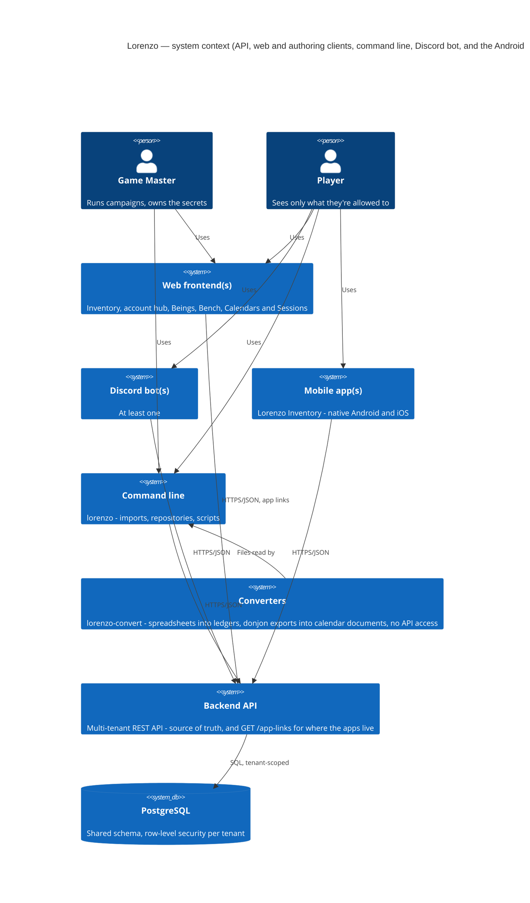

# System context

Every client (web, bot, mobile, command line) is a narrower view onto the same API, and there can be more than one of each — see [ADR 0007](../../adr/0007-apps-layout-and-multiplicity.md) and the [architecture overview](../overview.md). The web apps, which link to each other, learn where the others live from the API's registry of app links, `GET /app-links` ([ADR 0273](../../adr/0273-app-links-registry.md)); they share no navigation shell. Converters read a source file and write a native document; they never call the API, and the command line imports what they write ([ADR 0246](../../adr/0246-lorenzo-converters-the-spreadsheet-converter.md), [ADR 0311](../../adr/0311-calendar-documents-import-and-app.md)).
